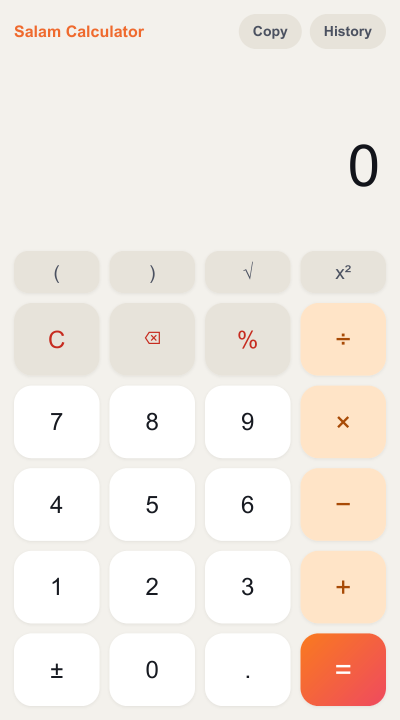
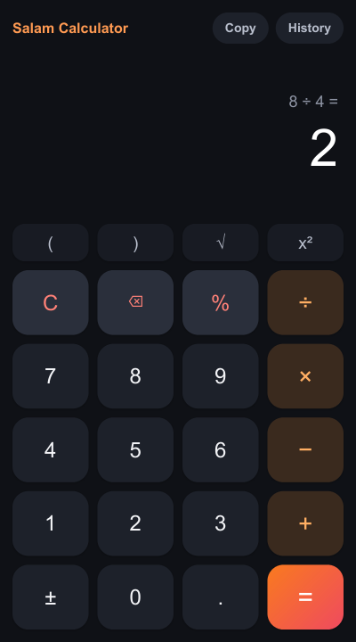
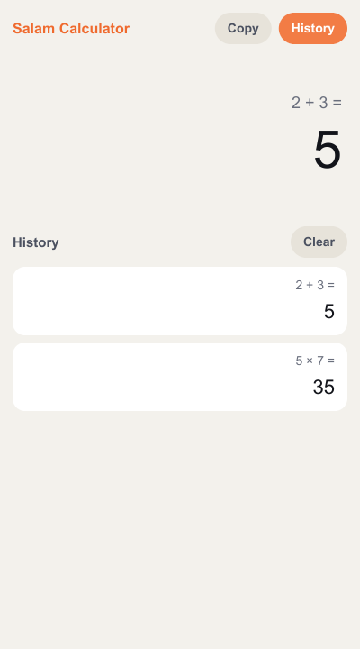
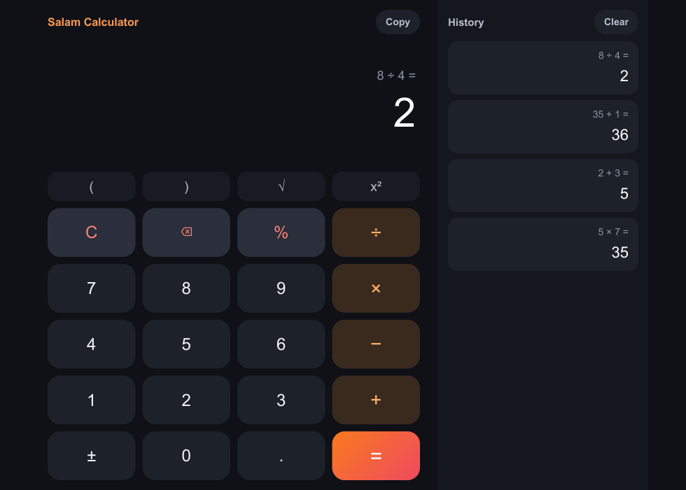

# Salam Calculator

A precise, friendly calculator for phones and computers, written entirely in the
[Salam programming language](https://github.com/SalamLang/Salam). The window is
described with Salam's page language and drawn natively, with no browser engine.

| Light | Dark | History |
| --- | --- | --- |
|  |  |  |



## Features

- Exact decimal arithmetic: `0.1 + 0.2` is `0.3`
- Correct operator order, brackets, square root, square and sign change
- Percent the way phone calculators do it: `100 + 10%` is `110`
- Live result while you type, and `=` again to repeat the last operation
- History that is kept between launches; tap an entry to use its result
- Copy the result with one button or `Ctrl+C` / `Cmd+C`
- Light and dark appearance that follows the system
- Layouts for phones, landscape screens and wide windows
- Haptic feedback on phones
- Full keyboard control on computers

## Keyboard

| Key | Action |
| --- | --- |
| `0` to `9`, `.` or `,` | type a number |
| `+` `-` `*` `/` (also `x`) | operators |
| `(` `)` `%` | brackets and percent |
| `r`, `^` | square root, square |
| `Enter` or `=` | result |
| `Backspace` | delete one symbol |
| `Delete`, `Esc` or `c` | clear |
| `Ctrl+C`, `Cmd+C` | copy the result |

## Platforms

macOS, Windows, Linux, Android and iOS. Every push builds all of them in GitHub
Actions and keeps the packages as workflow artifacts.

## Build

You need [Salam](https://github.com/SalamLang/Salam) 0.7.1 or newer.

```sh
salam run . --ui=native
```

| Command | Result in `dist/` | Needs |
| --- | --- | --- |
| `./build.sh macos` | `.dmg` | Xcode command line tools |
| `./build.sh linux` | `.tar.gz` and `.deb` | a C compiler, `libx11-dev` |
| `./build.sh windows` | `.zip` | mingw-w64 |
| `./build.sh android` | `.apk` | Android SDK with an NDK, JDK 21 |
| `./build.sh ios` | simulator app and unsigned `.ipa` | macOS with Xcode |

`SALAM=/path/to/salam` picks another compiler and `VERSION=1.2.0` sets the
version.

## Test

```sh
./tools/test.sh
```

It checks the page, runs the calculator logic tests and drives the real window
without a display.

## Layout

| Folder | Contents |
| --- | --- |
| `main.salam` | the page and the window |
| `components/` | one component per file |
| `app/` | the session: what each button and key does |
| `core/` | expression editing, parsing, exact arithmetic, number formatting |
| `theme/` | colours, key styles and text sizes |
| `storage/` | the saved history |
| `tests/` | logic and window tests |
| `tools/`, `build.sh` | building, testing and packaging |

## Releases

Pushing a tag such as `v1.0.0` builds every platform and publishes a GitHub
release with checksums.

To sign the Android release, add the repository secrets
`ANDROID_KEYSTORE_BASE64`, `ANDROID_KEY_ALIAS`, `ANDROID_KEYSTORE_PASSWORD` and
`ANDROID_KEY_PASSWORD`. Without them the APK is a debug build.

## License

[GPL-3.0](LICENSE)
